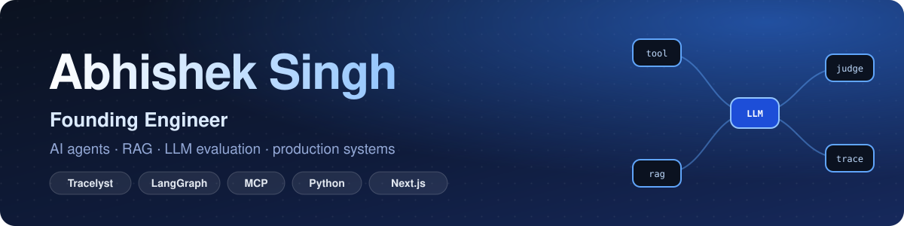

<h1 align="center">Hi 👋 I'm <b>Abhishek Singh</b></h1>

<h3 align="center"><b>Founding Engineer · Building AI agents, RAG and evaluation systems</b></h3>

<b>Founding Engineer</b> @ProPeers · I design and ship multi-agent, tool-calling and RAG workflows that turn business problems into reliable, measurable AI · Noida, India

  
  
  
  
  
  

  

---

## 👋 About Me

- 🚀 **Founding Engineer** at **ProPeers** (since July 2025). Before that, Software Engineer there from December 2024.
- 🛡️ I own **Tracelyst**, a live AI content-protection platform that finds pirated copies of a client's content, proves each match with perceptual hashing, embeddings and an **LLM-as-judge**, and runs staff-verified takedowns with credit-based billing. [See it live](https://platform-hazk1.centralindia.cloudapp.azure.com).
- 🤖 I work on agent systems end to end: **LangGraph** and **LangChain** agents, tool and function calling, an **MCP** server, retrieval and evaluation.
- 🔎 Built **semantic search for 100,000+ users**, and refactored **150+ REST APIs** to cut backend latency by **70%**.
- 🎙️ Side project: a realtime call assistant with voice activity detection, streaming speech-to-text and turn-aware answers.
- 🧠 About **600 DSA problems** solved, ranked in the **top 500** of GeeksforGeeks University Rankings.
- 🏆 **1st place** at a college hackathon, against 120+ participants.
- 🎓 B.Tech in Computer Science and Engineering, **VIT Bhopal** (2021 to 2025).
- 📬 Happy to talk about AI agents, RAG, evaluation and platform engineering. The quickest way is [email](mailto:rawatabhiips@gmail.com).

---

## 💼 Professional Experience

### **ProPeers**

#### **Founding Engineer** · July 2025 – Present · Noida, India (Hybrid)

* 🛡️ **Tracelyst.** Designed, built and deployed a full-stack AI platform (Python, MongoDB, Next.js, Redis job queues) that finds infringing copies of a client's content across Google, YouTube, Reddit, Telegram and other platforms, with evidence capture, a staff-verified takedown process, credit-based billing and an analytics dashboard.

* ⚖️ **Matching you can trust.** Perceptual hashing, vector embeddings and an LLM-as-judge decide whether a found item is really the client's media, with a human in the loop before any takedown.

* 🧩 **Multi-agent platform and MCP server.** Helped build ProPeers' multi-agent platform, where several LangGraph agents share one tool server, memory and context compression.

* 🎯 **AI Interview Agent.** An adaptive multi-agent interview system on GPT-4 that generates each next question from the candidate's live answers, with prompt templates, output guardrails and an on-screen code editor with live execution and AI-guided hints.

* 📣 **Social Media AI Agent.** Python, LangChain and RAG, with API integrations for hashtag recommendations, competitor analysis, trending-content detection and AI-generated SEO copy.

* 📚 **AskAI.** A knowledge assistant for data structures and algorithms with contextual memory, context-window management and semantic search over a vector database.

* 📈 **Operations.** Prometheus and Grafana dashboards for metrics and anomaly detection, and zero-downtime deployments through Docker, GitLab CI/CD and Azure App Service.

* ⚡ **Frontend performance.** Cut Total Blocking Time, First Contentful Paint and LCP by over 75% in React and Next.js apps with lazy loading, Suspense and edge caching.

---

#### **Software Engineer** · December 2024 – June 2025 · Remote

* 🔍 **Semantic search** with cosine-similarity vector matching (Sentence-Transformers and a custom OpenAI embedding model), serving natural-language queries for **100,000+ users**.

* 🛠️ **API and infrastructure.** Refactored **150+ REST APIs** with async execution, Redis caching and queues for a **70%** latency reduction, and moved MongoDB to self-hosted replica sets with automated Azure Blob Storage backups.

* ✉️ **Email automation.** Redis Queue with AWS SES to send targeted campaigns to **100,000+** active users, with retries and failure handling.

* 💸 **Automated payouts.** A Redis-backed workflow that calculates and distributes mentor earnings with no manual payment processing.

---

## 🌐 Live products I've worked on

| Product | What it is |
| --- | --- |
| [**Tracelyst**](https://platform-hazk1.centralindia.cloudapp.azure.com) | AI platform that finds pirated copies of a client's content and runs the takedown workflow |
| [**Creator Grid**](https://www.propeers.in/digitalProducts?productType=agentProduct) | AI agents for social media creators on ProPeers |
| [**AI Interview**](https://www.propeers.in/digitalProducts?productType=aiInterview) | Company-style AI interview simulators on ProPeers |

---

## 🧠 DSA

  
  
  
  

---

## 🎓 Certifications

| Course | Issuer | Completed |
| --- | --- | --- |
| [**Competitive Programming**](https://ninjasfiles.s3.amazonaws.com/certificate2420696e88fc1fa29d821907d91ae8744bca6fc.pdf) | Coding Ninjas | Sep 2022 · 300 questions |
| [**Advance Front-End Web Development With React - Full Stack**](https://ninjasfiles.s3.amazonaws.com/certificate1974974973c38df3dbe59327406026fa08a56be.pdf) | Coding Ninjas | Aug 2022 |
| [**Back End \| Full Stack Web Development In Node.js**](https://ninjasfiles.s3.amazonaws.com/certificate19749768f126d8faa893d4ffa68cb7d4c0f2237.pdf) | Coding Ninjas | Jun 2022 |
| [**Front End \| Full Stack Web Development**](https://ninjasfiles.s3.amazonaws.com/certificate1974975707c3dbaad83f325fe1dac67224cc228.pdf) | Coding Ninjas | Mar 2022 |
| [**Data Structures In C++**](https://ninjasfiles.s3.amazonaws.com/certificate1745523a635499e0f83c793ce35868e6add3d79.pdf) | Coding Ninjas | Jan 2022 · 300 questions |

The two DSA courses, Data Structures In C++ and Competitive Programming, have 300 questions each.

---

## 🛠️ Tech Stack

**Languages**

**AI and agents**

**Data, cloud and delivery**

**Frontend**

---

## 🚀 Open source and personal projects

| Project | What it is | Stack |
| --- | --- | --- |
| [**Krypty**](https://github.com/rawift/krypty) | Send ETH with a custom message on-chain. A Hardhat-built Solidity contract with immutable storage, and a React frontend with MetaMask wallet integration. | Solidity · Hardhat · React · Tailwind CSS |
| [**QuickArt**](https://github.com/rawift/quickart) | Full-stack MERN e-commerce platform with Stripe payments, JWT authentication, product management, a cart and real-time inventory updates. | MongoDB · Express · React · Node.js · Stripe |
| [**Ethereum Deposit Tracker**](https://github.com/rawift/Etherem_Dep_Tracer) | Node.js app that follows the Beacon deposit contract, with Prometheus and Grafana for metrics and Loki for logs. Runs directly or in Docker. | Node.js · Prometheus · Grafana · Loki · Docker |
| [**Social-Media**](https://github.com/rawift/Social-Media) | A small social site with posts, comments and likes, plus email through Nodemailer. | Node.js · Express · EJS · AJAX |

Most of my work at ProPeers lives in private repositories, so this page shows the public ones.

---

## 📊 GitHub Stats

  
  

  

---

## 📧 Connect with me

  
  

